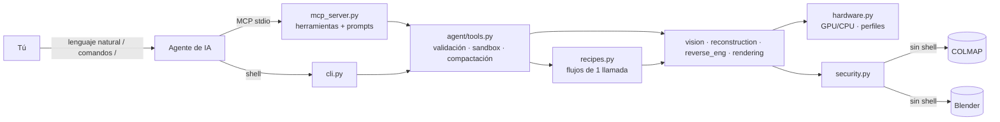

<div align="center">

# reverse3d

**Modelado 3D e ingeniería inversa con tu agente de IA, en local**

Fotos → modelo 3D medido · Plano o careta → pieza · Escaneo → CAD paramétrico · Render automático.
Se instala pasándole la URL del repo a tu agente y funciona con Claude, Cursor, VS Code/Copilot, Gemini, Codex, OpenCode, Windsurf y cualquier cliente MCP. En GPU o en CPU.

[](https://github.com/rellytechgame/Reverse3D-tool/actions/workflows/ci.yml)
[](https://www.python.org/)
[](LICENSE)
[](docs/mcp.md)
[](#-gpu-o-cpu)
[](SECURITY.md)

Desarrollado por **[Voxel Enterprise](https://voxel.lat)**

</div>

---

## Tabla de contenidos

- [⚡ Instalación en 1 minuto](#-instalación-en-1-minuto)
- [🗣️ Úsalo con tu agente](#️-úsalo-con-tu-agente)
- [🚀 GPU o CPU](#-gpu-o-cpu)
- [💰 Ahorro de tokens](#-ahorro-de-tokens)
- [🔌 Sin internet (modo offline)](#-sin-internet-modo-offline)
- [🤖 Piloto automático](#-piloto-automático)
- [Capacidades](#capacidades)
- [Herramientas externas opcionales](#herramientas-externas-opcionales)
- [Referencia de la CLI](#referencia-de-la-cli)
- [Configuración](#configuración)
- [Integración avanzada](#integración-avanzada)
- [Stack tecnológico](#stack-tecnológico)
- [Arquitectura](#arquitectura)
- [Seguridad](#seguridad)
- [🔏 Autenticidad y autoría](#-autenticidad-y-autoría)
- [Solución de problemas](#solución-de-problemas)
- [Estructura del repositorio](#estructura-del-repositorio)
- [Desarrollo](#desarrollo)
- [Hoja de ruta](#hoja-de-ruta)
- [Sobre Voxel Enterprise](#sobre-voxel-enterprise)
- [Licencia](#licencia)

---

## ⚡ Instalación en 1 minuto

**No necesitas instalar nada antes**: ni Python, ni Git, ni permisos de administrador. Solo conexión a internet y unos 4 GB libres.

### Opción 1 — Pídeselo a tu agente (recomendado)

Copia y pega **esta frase** en tu agente de IA (Claude Code, Codex, Cursor, Gemini CLI, OpenCode, Copilot, Windsurf…):

```text
Instala reverse3d desde https://github.com/rellytechgame/Reverse3D-tool siguiendo su AGENTS.md. Tienes mi permiso para ejecutar el instalador; no me hagas preguntas.
```

Eso es todo. Tu agente te pedirá permiso **una sola vez**, para ejecutar el instalador; acéptalo, por ejemplo con *"Sí"* o *"Permitir siempre"*. A partir de ahí no te preguntará nada más:

- instala Python, todos los módulos, **Blender** (renders fotorrealistas) y **COLMAP** (fotos → 3D);
- detecta tu tarjeta gráfica (GPU) y la usa si existe;
- conecta reverse3d con **todos** tus agentes de IA y deja sus herramientas **aprobadas**, para que no te pidan permiso en cada uso;
- comprueba que todo funciona.

Tarda entre 10 y 20 minutos según tu conexión. Al terminar, **cierra y vuelve a abrir tu agente**.

¿Quieres algo concreto? Dilo en la misma frase:

```text
Instala reverse3d desde https://github.com/rellytechgame/Reverse3D-tool siguiendo su AGENTS.md, en modo ligero y usando solo CPU. Tienes mi permiso; no me hagas preguntas.
```

### Opción 2 — Un comando en la terminal

**Linux / macOS**

```bash
curl -fsSL https://raw.githubusercontent.com/rellytechgame/Reverse3D-tool/main/scripts/install.sh | bash
```

**Windows (PowerShell)**

```powershell
irm https://raw.githubusercontent.com/rellytechgame/Reverse3D-tool/main/scripts/install.ps1 | iex
```

Con opciones:

```bash
# Linux/macOS: GPU + calidad máxima
curl -fsSL https://raw.githubusercontent.com/rellytechgame/Reverse3D-tool/main/scripts/install.sh | bash -s -- --device gpu --profile quality
```

```powershell
# Windows: GPU + calidad máxima
& ([scriptblock]::Create((irm https://raw.githubusercontent.com/rellytechgame/Reverse3D-tool/main/scripts/install.ps1))) -Device gpu -Performance quality
```

> ¿Prefieres revisar el script antes de ejecutarlo? Descárgalo, léelo y ejecútalo: `curl -fsSLO …/install.sh && less install.sh && bash install.sh`.

### Qué hace el instalador

**Nunca hace preguntas** y **no necesita administrador**. Si se interrumpe, por ejemplo porque el agente lo corta por tiempo, basta con volver a ejecutarlo: **continúa donde se quedó**.

1. **Python:** descarga [uv](https://docs.astral.sh/uv/) y con él un Python 3.12 privado en `~/.reverse3d`. No toca el Python de tu sistema; si uv no está disponible, usa un Python ≥ 3.10 que ya tengas.
2. **Entorno aislado** en `~/.reverse3d/venv`.
3. **reverse3d con todos los módulos:**
   - mallado (Open3D);
   - render (PyVista);
   - IA de profundidad (PyTorch): con CUDA si hay GPU NVIDIA y, si no, la versión CPU, mucho más ligera.

   Si un módulo opcional falla, la instalación **sigue** y lo indica al final.
4. **Blender 5.2 y COLMAP 4.2 portables** en `~/.reverse3d/tools`. Las versiones están fijadas y cada descarga se verifica con su huella **SHA-256** oficial.
   - En Linux no existe un COLMAP portable: se instala con `apt` o `brew` solo si no hace falta contraseña. Si no se puede, el instalador lo indica y todo lo demás funciona.
5. Deja el comando `reverse3d` disponible: `~/.local/bin` en Linux/macOS, PATH de usuario en Windows.
6. Ejecuta **`reverse3d setup`**, que registra el servidor MCP en **todos los agentes que encuentre**:

| Agente | Dónde se registra |
|--------|-------------------|
| Claude Code | `claude mcp add --scope user` + Skill en `~/.claude/skills/reverse3d` |
| Claude Desktop | `claude_desktop_config.json` |
| Cursor | `~/.cursor/mcp.json` |
| Windsurf | `~/.codeium/windsurf/mcp_config.json` |
| VS Code (Copilot) | `<user>/Code/User/mcp.json` |
| Gemini CLI | `~/.gemini/settings.json` |
| OpenCode | `~/.config/opencode/opencode.json` |
| Codex CLI | `~/.codex/config.toml` |

Cada archivo modificado se **respalda antes** (`*.reverse3d-backup-<fecha>`). Solo se toca la entrada `reverse3d` y, si un archivo no se puede leer con seguridad (por ejemplo, JSON con comentarios), **no se modifica** y se muestra el bloque para pegarlo a mano.

   **Herramientas aprobadas de antemano**, para que el agente no te pregunte en cada uso:

   | Agente | Aprobación automática |
   |--------|-----------------------|
   | Claude Code | `mcp__reverse3d` en `permissions.allow` de `~/.claude/settings.json` |
   | Gemini CLI | `"trust": true` en la entrada `reverse3d` |
   | Resto | No tienen ese ajuste: la primera vez elige **"Permitir siempre"** |

   Solo se aprueban las herramientas de reverse3d, que trabajan **únicamente dentro del workspace** (ver [Seguridad](#seguridad)). Para desactivarlo usa `--no-auto-approve`.

7. Verifica todo con `reverse3d doctor` y guarda el resultado en `~/.reverse3d/install-status.json`. El registro completo queda en `~/.reverse3d/install.log`. **Reinicia tu agente** y listo.

#### Opciones del instalador

| bash (`install.sh`) | PowerShell (`install.ps1`) | Efecto |
|---------------------|----------------------------|--------|
| *(sin opciones)* | *(sin opciones)* | **Todo**: núcleo, MCP, render, mallado, IA local (con CUDA si hay NVIDIA), Blender y COLMAP |
| `--lite` | `-Lite` | Todo, con la IA local en la CPU (PyTorch CPU, ~250 MB en vez de ~2.5 GB) |
| `--minimal` | `-Minimal` | Núcleo + MCP + IA local, sin herramientas externas |
| `--no-tools` | `-NoTools` | No instalar Blender ni COLMAP |
| *(en todos los modos)* | *(en todos los modos)* | **La IA local se instala y se descarga siempre** (clasificador, segmentación, profundidad y puntos con IA, unos 800 MB) para que todo funcione sin internet |
| `--no-auto-approve` | `-NoAutoApprove` | Que los agentes pregunten antes de cada herramienta |
| `--with recon,depth` | `-With recon,depth` | Extras a elección |
| `--device auto\|cpu\|gpu` | `-Device …` | Dispositivo por defecto |
| `--profile fast\|balanced\|quality` | `-Performance …` | Perfil de rendimiento |
| `--toolset lean` | `-Toolset lean` | Expone 5 herramientas en lugar de 14 (menos tokens) |
| `--agents auto\|all\|claude-code,cursor` | `-Agents …` | Qué agentes registrar |
| `--workspace DIR` | `-Workspace DIR` | Carpeta que pueden usar los agentes (por defecto `~/reverse3d-workspace`) |
| `--ref v0.2.0` | `-Ref v0.2.0` | Instalar una versión o etiqueta concreta |
| `--source .` | `-Source .` | Instalar desde un clon local |
| `--no-setup` | `-NoSetup` | No registrar agentes |
| `--uninstall` | `-Uninstall` | Desinstalar (conserva el workspace y la configuración) |

### Opción 3 — Sin instalar nada (con `uv`)

Si tienes [uv](https://docs.astral.sh/uv/), cualquier cliente MCP puede ejecutar reverse3d directamente desde GitHub:

```json
{
  "mcpServers": {
    "reverse3d": {
      "command": "uvx",
      "args": ["--from", "reverse3d[mcp,render] @ git+https://github.com/rellytechgame/Reverse3D-tool",
               "reverse3d", "agent", "mcp"],
      "env": { "REVERSE3D_WORKSPACE": "/ruta/a/mi-workspace" }
    }
  }
}
```

### Opción 4 — Manual (desarrolladores)

```bash
git clone https://github.com/rellytechgame/Reverse3D-tool.git && cd Reverse3D-tool
python -m venv .venv && source .venv/bin/activate      # Windows: .venv\Scripts\Activate.ps1
pip install -e ".[mcp,render]"                          # o ".[all]" / ".[dev]"
reverse3d setup                                         # registra en tus agentes
reverse3d doctor
```

---

## 🗣️ Úsalo con tu agente

Coloca tus archivos en el workspace (`~/reverse3d-workspace`) y **habla normal**:

> *"Convierte las fotos de `taza/` en un modelo 3D y dime sus medidas."*
> *"Este plano `soporte.png` mide 120 mm de ancho; sácame la pieza con 4 mm de espesor."*
> *"Repara `escaneo.stl`, alinéalo y genérame el código OpenSCAD."*
> *"Hazme un render de `pieza.glb` en azul metálico."*
> *"Usa la GPU de ahora en adelante."* · *"Cambia a modo rápido."*

### Comandos `/` (prompts MCP)

En los clientes que muestran prompts MCP como comandos (Claude Code: `/mcp__reverse3d__<nombre>`; Claude Desktop: menú **+ → reverse3d**; también VS Code y otros):

| Comando | Qué hace |
|---------|----------|
| `procesar <entrada>` | Lo que sea → detecta qué es y lo procesa solo |
| `fotos-a-3d <carpeta>` | Fotos → modelo 3D medido + render |
| `plano-a-pieza <imagen> [espesor] [mm_por_pixel]` | Plano o careta → pieza extruida |
| `escaneo-a-cad <malla>` | Malla → limpieza + cotas + primitivas + OpenSCAD/CadQuery |
| `foto-a-relieve <imagen>` | Una foto → relieve 2.5D con IA |
| `medir <malla>` | Cotas, volumen y render |
| `usar-gpu` · `usar-cpu` | Cambiar el dispositivo |
| `rendimiento <fast\|balanced\|quality>` | Cambiar el perfil |
| `estado` | Qué está instalado, GPU detectada y configuración |

### Recetas: un flujo completo en una sola llamada

| Receta | Entrada | Resultado en `output_dir/` |
|--------|---------|----------------------------|
| `auto` | **Lo que sea** | Detecta el tipo, elige la receta y reintenta si sirve; añade `RESUMEN.md` |
| `photos_to_model` | Carpeta de fotos | `model.stl`, `render.png`, `report.json`, nube de puntos |
| `plan_to_part` | Plano, careta o silueta | `model.stl`, `render.png`, contornos SVG |
| `scan_to_cad` | STL/OBJ/PLY/GLB | `model.stl`, `cad.scad`, `cad.py` (CadQuery), `render.png` |
| `photo_to_relief` | Una foto | `model.stl` (relieve 2.5D), `render.png` |
| `mesh_report` | Una malla | Cotas + `render.png` |

Desde la terminal: `reverse3d run plan_to_part plano.png salida/ --thickness 4 --units-per-pixel 0.5`.

---

## 🚀 GPU o CPU

reverse3d **detecta tu GPU automáticamente**: NVIDIA CUDA mediante `nvidia-smi` y Apple Silicon (MPS). Si pides GPU y no está disponible, **pasa a CPU solo, sin fallar**: por ejemplo, con un COLMAP compilado sin CUDA.

| Cómo cambiarlo | GPU | CPU | Automático |
|----------------|-----|-----|------------|
| Hablando con tu agente | *"usa la GPU"* | *"usa la CPU"* | *"modo automático"* |
| Comando `/` | `usar-gpu` | `usar-cpu` | — |
| Herramienta | `reverse3d_configure {"device":"gpu"}` | `{"device":"cpu"}` | `{"device":"auto"}` |
| CLI persistente | `reverse3d config set device gpu` | `… device cpu` | `… device auto` |
| CLI solo esta vez | `reverse3d --device gpu run …` | `--device cpu` | — |
| Variable de entorno | `REVERSE3D_DEVICE=gpu` | `=cpu` | `=auto` |

Los cambios desde el agente **se aplican al instante**, sin reiniciar: el servidor relee la configuración en cada llamada.

| Componente | Usa la GPU para |
|------------|-----------------|
| COLMAP (build CUDA) | Extracción y matching SIFT + reconstrucción densa MVS |
| Blender Cycles | Render con OptiX, CUDA, HIP, Metal u oneAPI (el que haya disponible) |
| Depth Anything (PyTorch) | Inferencia en CUDA o Apple MPS |

### Perfiles de rendimiento

| Perfil | Fotogrametría | Muestras de render | Resolución de render | Detalle de relieve | Muestras para primitivas |
|--------|---------------|--------------------|----------------------|--------------------|--------------------------|
| `fast` | low | 16 | 960×720 | 1/4 | 8 000 |
| `balanced` *(defecto)* | medium | 64 | 1600×1200 | 1/2 | 20 000 |
| `quality` | high | 256 | 2400×1800 | completo | 50 000 |

Cambia el perfil con *"modo rápido"*, `rendimiento quality`, `reverse3d config set profile fast` o `--profile`. Los argumentos explícitos de una herramienta siempre tienen prioridad sobre el perfil. Hilos de CPU: `reverse3d config set threads 8`.

---

## 💰 Ahorro de tokens

reverse3d está diseñado para gastar poco contexto del modelo:

| Técnica | Cómo | Ahorro medido* |
|---------|------|----------------|
| **Recetas** | 1 llamada en lugar de 5–6; el detalle completo va a `report.json` en disco | **−82 %** de tokens de resultados y 5 → 1 idas y vueltas |
| **Salida compacta** (por defecto) | Rutas relativas, números redondeados, sin nulos, listas recortadas, solo lo relevante | −44 % por llamada |
| **Toolset `lean`** | Expone 5 herramientas (las recetas cubren el resto) | Esquemas: 4 147 → 1 466 tokens (−65 %) |
| **Skill de Claude Code** | Guía que el agente carga solo cuando hace falta | 0 tokens fijos |
| **Errores con `hint`** | El agente se corrige a la primera, sin bucles | — |

<sub>*Flujo plano → pieza con 5 pasos medido en la v0.2.0, a ~4 caracteres por token. Cada ida y vuelta evitada ahorra además reenviar todo el historial de la conversación.</sub>

```bash
reverse3d config set toolset lean       # menos herramientas = menos tokens (reinicia el agente)
reverse3d config set verbosity full     # si alguna vez necesitas el detalle completo
```

---

## 🔌 Sin internet (modo offline)

reverse3d **funciona sin conexión**. Todo el cálculo es local (OpenCV, COLMAP, Open3D, trimesh, Blender). Lo único que se descarga son los modelos de IA local (sujeto, recorte, profundidad y los puntos ALIKED + LightGlue), y **el instalador los deja descargados**.

- **Cambio automático:** si el equipo no detecta internet, reverse3d pasa solo a modo offline. No tienes que hacer nada.
- **Comprobar:** `reverse3d offline status` dice si hay conexión y qué funciona sin ella. `reverse3d doctor` lo incluye en su informe.
- **Preparar a mano:** `reverse3d offline prepare` descarga los modelos (solo `safetensors`, en una revisión fijada y revisada) en `~/.reverse3d/models`. Usa `--all` para incluir también los modelos grandes CC-BY-NC.
- **Forzarlo:** `reverse3d config set offline on`, para no usar nunca la red. Con `off` reverse3d asume que hay conexión y no la comprueba; el valor por defecto es `auto`.

| Sin internet funciona | Necesita |
|-----------------------|----------|
| Medir, reparar, primitivas, CAD (OpenSCAD/CadQuery), plano → pieza | nada |
| Fotogrametría (fotos → 3D) y render | COLMAP / Blender instalados (el instalador lo hace) |
| Foto → relieve con IA | el modelo descargado una vez (el instalador lo hace) |

> Tu agente de IA (Claude, Cursor, Copilot…) sí necesita internet. Sin agente, usa el **piloto automático** o la CLI.

## 🤖 Piloto automático

**No hace falta elegir receta ni tener un agente.** reverse3d detecta qué le das y lo procesa:

```bash
reverse3d auto bandeja/taza          # carpeta de fotos → modelo 3D medido
reverse3d auto plano.png             # plano o silueta → pieza extruida
reverse3d auto pieza.stl             # malla → reparación + cotas + CAD
```

O déjalo trabajando solo con la **carpeta vigilada**:

```bash
reverse3d watch
```

1. Suelta en `~/reverse3d-workspace/bandeja` una carpeta de fotos, un plano, una foto o un STL/OBJ/PLY/GLB.
2. Cuando termina de copiarse, se procesa solo. El resultado aparece en `resultados/<nombre>/`, con un **`RESUMEN.md`** que explica qué detectó, las medidas, los archivos y el siguiente paso.
3. El original se mueve a `bandeja/_procesado/`. Si algo falla, va a `bandeja/_revisar/` con un `LEEME.txt` que dice qué corregir.

**Qué decide solo:**

| Detecta | Hace | Si falla, reintenta con |
|---------|------|-------------------------|
| Carpeta con 3 o más fotos | `photos_to_model` | calidad `high` |
| Imagen de alto contraste o con fondo transparente | `plan_to_part` | otros métodos de máscara (adaptativo, bordes) |
| Foto normal | `photo_to_relief` | — |
| Malla (STL/OBJ/GLB/PLY con caras) | `scan_to_cad` | reparación fuerte si no queda cerrada |
| Nube de puntos (XYZ/PCD/PLY sin caras) | mallado Poisson + `scan_to_cad` | — |

Si las fotos están borrosas o falta una herramienta, **no reintenta en vano**: te explica qué cambiar. Funciona sin internet y sin modelo de IA, porque son reglas, no adivinanzas.

---

## Capacidades

| Área | Qué hace | Tecnología |
|------|----------|------------|
| 🖼️ **Análisis de capturas** | Nitidez, exposición, textura y solape entre vistas, con recomendaciones | OpenCV (SIFT/ORB + RANSAC) |
| ✂️ **Máscaras y planos** | Siluetas y contornos vectoriales (con agujeros) desde fotos, planos, caretas o PNG con alfa | OpenCV |
| 🧱 **Plano → pieza** | Extrusión de contornos a sólido 3D con escala real | Shapely + trimesh |
| 📷 **Fotogrametría** | Fotos → SfM → MVS denso → nube → malla | COLMAP + Open3D |
| 🌊 **Profundidad con IA** | Una foto → mapa de profundidad → relieve 2.5D | Depth Anything V2 |
| 🎨 **Texturas** | Textura fotográfica 2048² desde las propias fotos (UV, visibilidad, sin costuras) en `model.glb` | xatlas + OpenCV |
| 🧠 **Puntos con IA** | Rescate automático de capturas difíciles con puntos y emparejamiento aprendidos | ALIKED + LightGlue (ONNX) |
| 🛠️ **Reparación de mallas** | Limpieza, restos sueltos, agujeros, normales, Taubin, decimación, alineación OBB/PCA, escala | trimesh |
| 📏 **Metrología** | Cotas AABB/OBB, área, volumen, centro de masa, estanqueidad | trimesh |
| 📐 **Primitivas** | Planos, cilindros y esferas con RANSAC (radios, ejes, normales) | NumPy |
| 🧩 **CAD paramétrico** | Código **OpenSCAD** y **CadQuery** editable | — |
| 🎬 **Render** | Blender headless (Cycles/Eevee, turntable) o PyVista | Blender `bpy` / PyVista |
| 🤖 **Agentes** | 14 herramientas, 10 comandos `/`, recetas, autoconfiguración en 8 agentes | MCP + JSON Schema |
| 🛰️ **Piloto automático** | Detección de la entrada, reintentos inteligentes, carpeta vigilada, `RESUMEN.md` | Reglas deterministas, sin IA |
| 🔌 **Offline** | Detección de conexión, cambio automático, modelos fijados por revisión | `~/.reverse3d/models` |

**Formatos:** imágenes `png jpg jpeg tif tiff bmp webp`, y fotos de iPhone `heic heif` (se convierten a JPEG conservando el EXIF) · mallas `stl obj ply glb gltf off` · nubes `ply xyz pcd`.

**Perfiles de escena:** reverse3d predice si las fotos son de un objeto, un personaje, arquitectura o un paisaje (`reverse3d scene detect <carpeta>`) y ajusta la reconstrucción; también puedes elegirlo con `reverse3d auto <carpeta> --scene architecture`.

**¿Cómo tomar las fotos?** Mínimo 20, recomendadas 40-60, en 4 perfiles (anillos a 10-20°, 35-45° y 60-70°, y 4 desde arriba), sin mover el objeto, con luz pareja y sin reflejos. Guía completa: [docs/captura.md](docs/captura.md).

---

## Herramientas externas opcionales

**El instalador las instala solo** (salvo `--no-tools`/`--minimal`). reverse3d funciona sin ellas, pero desbloquean más potencia. Comprueba en cualquier momento con `reverse3d doctor` o con el comando `estado`.

| Herramienta | Para qué | Windows | macOS | Linux |
|-------------|----------|---------|-------|-------|
| **Blender 5.2** (vale 3.6+) | Render fotorrealista | ✅ automático (portable) | ✅ automático en Apple Silicon; Intel: `brew` si existe | ✅ automático en x86-64 (portable) |
| **COLMAP 4.2** | Fotogrametría (fotos → 3D) | ✅ automático; build **CUDA** si hay NVIDIA | ✅ automático en Apple Silicon; Intel: `brew` si existe | Solo con `apt`/`dnf`/`brew` sin contraseña; si no: `sudo apt install colmap` |
| **Open3D** | Mallado de nubes de puntos | ✅ automático (Python 3.12 privado) | ídem | ídem |
| **PyTorch** | Profundidad con IA | ✅ automático (CUDA si hay NVIDIA) | ✅ automático (MPS) | ✅ automático (CUDA o CPU) |

Si quieres usar un Blender o COLMAP propio: `reverse3d config set blender "C:\Program Files\Blender Foundation\Blender 4.2\blender.exe"` (igual con `colmap`).

---

## Referencia de la CLI

```
reverse3d [--json] [--device auto|cpu|gpu] [--profile fast|balanced|quality] [--workspace DIR] <comando>
```

| Comando | Descripción |
|---------|-------------|
| `auto ENTRADA [SALIDA]` | Piloto automático: detecta la entrada y la procesa (salida por defecto: `resultados/<nombre>`) |
| `watch [BANDEJA] [--out DIR] [--once]` | Carpeta vigilada: procesa sola lo que dejes en `bandeja/` |
| `offline status` · `offline prepare [--all]` | Qué funciona sin internet · descargar los modelos de IA |
| `run <receta> ENTRADA SALIDA` | Flujos completos: `auto`, `photos_to_model`, `plan_to_part`, `scan_to_cad`, `photo_to_relief`, `mesh_report` |
| `setup [--agents …] [--dry-run] [--uninstall] [--snippets]` | Registra o elimina reverse3d en tus agentes |
| `config show \| set K V \| unset K \| path` | Configuración persistente (`~/.reverse3d/config.json`) |
| `doctor` | Capacidades, GPU, extras, binarios y límites |
| `vision analyze DIR` · `vision match A B` | Calidad y solape de capturas |
| `vision mask IMG OUT` · `vision extrude CONTOURS OUT` | Máscaras, contornos y extrusión |
| `recon photo DIR OUT` · `recon depth IMG OUT` · `recon mesh CLOUD OUT` | Reconstrucción |
| `mesh clean IN OUT` · `mesh measure IN` · `mesh fit IN [--parametric x.scad]` | Ingeniería inversa |
| `render MESH OUT.png [--turntable 36]` | Render |
| `agent tools [--format anthropic\|openai\|gemini] [--toolset lean]` | Esquemas de herramientas |
| `agent call NOMBRE --args JSON` | Ejecuta una herramienta con sandbox |
| `agent mcp` | Servidor MCP (stdio) |

**Códigos de salida:** `0` OK · `1` error · `2` entrada inválida o seguridad · `3` falta una dependencia · `4` falló COLMAP o Blender.

---

## Configuración

**Prioridad:** valores por defecto ← `~/.reverse3d/config.json` (`reverse3d config set`) ← variables de entorno.

| Clave (`config set`) | Variable de entorno | Defecto | Descripción |
|----------------------|---------------------|---------|-------------|
| `workspace` | `REVERSE3D_WORKSPACE` | `~/reverse3d-workspace` (tras `setup`) | Carpeta sandbox de los agentes |
| `device` | `REVERSE3D_DEVICE` | `auto` | `auto` · `cpu` · `gpu` |
| `profile` | `REVERSE3D_PROFILE` | `balanced` | `fast` · `balanced` · `quality` |
| `verbosity` | `REVERSE3D_VERBOSITY` | `compact` | `compact` (ahorra tokens) · `full` |
| `toolset` | `REVERSE3D_TOOLSET` | `full` | `full` (14 herramientas) · `lean` (5) |
| `offline` | `REVERSE3D_OFFLINE` | `auto` | `auto` (detecta la conexión) · `on` (nunca usa la red) · `off` |
| `threads` | `REVERSE3D_THREADS` | `0` (auto) | Hilos de CPU |
| `timeout_s` | `REVERSE3D_TIMEOUT_S` | `3600` | Timeout por proceso externo |
| `max_input_mb` · `max_images` · `max_mesh_faces` · `max_image_pixels` | `REVERSE3D_MAX_*` | 512 · 500 · 5M · 100M | Límites de recursos |
| `blender` · `colmap` | `REVERSE3D_BLENDER` · `REVERSE3D_COLMAP` | PATH | Ruta a los binarios |
| — | `REVERSE3D_HOME` | `~/.reverse3d` | Ubicación de `config.json` y del venv |

reverse3d **no necesita credenciales** de ningún tipo.

---

## Integración avanzada

- **Function calling propio** (SDK de Anthropic, OpenAI o Gemini): `tool_definitions("anthropic" | "openai" | "gemini", toolset)` + `execute_tool(name, args, settings)`. Ver [docs/agent-integration.md](docs/agent-integration.md) y el agente de ejemplo [`examples/claude_agent.py`](examples/claude_agent.py).
- **Configuración MCP manual** para cualquier cliente: `reverse3d setup --snippets` imprime el JSON o TOML exacto. Ver [docs/mcp.md](docs/mcp.md).
- **Esquemas estáticos:** [`docs/tools/`](docs/tools/).
- **Agentes con terminal sin MCP:** `reverse3d --json agent call <tool> --args '{…}'` (mismo sandbox).

---

## Stack tecnológico

| Capa | Tecnologías |
|------|-------------|
| Lenguaje | Python 3.10+ con tipado estático (mypy) |
| Visión | OpenCV 4/5 (headless), Pillow |
| Geometría 3D | trimesh, NumPy, SciPy, Shapely, mapbox-earcut, NetworkX, fast-simplification |
| Reconstrucción | COLMAP (SfM/MVS, CUDA), Open3D (Poisson) |
| IA | PyTorch (CUDA / MPS), Hugging Face Transformers, Depth Anything V2 |
| Render | Blender 3.6–4.x headless (Cycles/Eevee, OptiX/CUDA/HIP/Metal), PyVista/VTK |
| Agentes | MCP (SDK 1.x y 2.x, herramientas y prompts), JSON Schema para Anthropic/OpenAI/Gemini, Agent Skills, AGENTS.md |
| CLI | Typer, Rich |
| Instalación | Instaladores bash/PowerShell, venv aislado, `uvx`, `pip` |
| Calidad y seguridad | pytest, ruff, mypy, bandit, CodeQL, pip-audit, gitleaks, SBOM CycloneDX, Dependabot |
| CI/CD | GitHub Actions (Linux/Windows/macOS × Python 3.10–3.13, actions fijadas por SHA) |

## Arquitectura



Detalle en [docs/architecture.md](docs/architecture.md).

## Seguridad

- **Sandbox de workspace:** los agentes solo leen y escriben dentro de su carpeta; se resuelven symlinks y referencias internas de glTF/OBJ.
- **Configuración por agente limitada:** con `reverse3d_configure` el agente solo puede cambiar `device`, `profile`, `verbosity` y `threads`. **Nunca** el workspace, los límites ni la ruta de Blender o COLMAP, porque eso equivaldría a ejecutar código arbitrario.
- **`setup` respetuoso:** respalda cada archivo, solo toca la entrada `reverse3d` y nunca reescribe archivos que no puede leer con seguridad.
- **Instaladores sin privilegios:** sin `sudo` ni administrador, en un venv aislado y con validación de argumentos. Se puede fijar la versión con `--ref`.
- **Procesos sin shell**, con timeout y entorno sin secretos. **Blender endurecido** (`--factory-startup --disable-autoexec`, script estático).
- **Modelos de IA:** lista blanca, solo safetensors y `trust_remote_code=False`.
- **CI:** bandit, CodeQL, pip-audit, gitleaks, SBOM y actions fijadas por SHA.

Detalle en [docs/security-model.md](docs/security-model.md). Para reportar vulnerabilidades, consulta [SECURITY.md](SECURITY.md).

## 🔏 Autenticidad y autoría

**reverse3d fue creado por y es propiedad de [Voxel Enterprise](https://voxel.lat).** El código es open source (Apache-2.0); **la autoría y el nombre no se ceden**.

- **Repo oficial blindado:** un *guardián de autoría* (`scripts/check_authorship.py`) bloquea en CI, en pre-commit y en los tests cualquier cambio de autor, licencia o copyright. CODEOWNERS exige la aprobación del propietario, y los agentes de IA tienen la regla explícita de no tocar la autoría ([AGENTS.md §4](AGENTS.md)).
- **Releases verificables:** solo se publican desde **tags firmados**, cada archivo lleva una **atestación de procedencia (Sigstore)** y PyPI usa *Trusted Publishing*. Para comprobar que tu copia es la oficial:
  ```bash
  gh attestation verify <archivo> --repo rellytechgame/Reverse3D-tool
  ```
- **Copias y forks:** están permitidos, pero deben **conservar la atribución** (Apache-2.0 §4, [NOTICE](NOTICE)) y **usar otro nombre** ([TRADEMARKS.md](TRADEMARKS.md)). Presentarse como autor o dueño de reverse3d no está permitido.

Más detalles, cómo reportar suplantaciones y la lista de blindaje del propietario: **[docs/authenticity.md](docs/authenticity.md)** · Autores: [AUTHORS.md](AUTHORS.md)

## Solución de problemas

| Problema | Solución |
|----------|----------|
| El agente no ve las herramientas | Reinicia el agente. Ejecuta `reverse3d setup` y revisa la columna `status`. Usa `reverse3d setup --snippets` para configurarlo a mano. |
| `reverse3d: command not found` | Abre una terminal nueva o usa `~/.reverse3d/venv/bin/reverse3d` (Windows: `%USERPROFILE%\.reverse3d\venv\Scripts\reverse3d.exe`). |
| `security_violation` | El archivo está fuera del workspace: muévelo a `~/reverse3d-workspace`. |
| La instalación se cortó a medias | Vuelve a ejecutar el mismo comando: continúa donde se quedó. El detalle está en `~/.reverse3d/install.log`. |
| `dependency_missing` | Falta Blender, COLMAP o un extra: vuelve a ejecutar el instalador sin `--lite`/`--minimal`. `~/.reverse3d/install-status.json` → `missing` dice qué falta y por qué. |
| No usa la GPU | Comprueba `reverse3d config show` → `hardware`. Si instalaste antes de tener los drivers NVIDIA, vuelve a ejecutar el instalador. |
| El agente pide permiso en cada herramienta | Claude Code y Gemini CLI quedan aprobados solos. En los demás, elige **"Permitir siempre"** la primera vez. |
| Fotogrametría lenta o con timeout | Usa el perfil `fast`, `reverse3d config set timeout_s 7200` y menos fotos o fotos más pequeñas. |
| `photos_to_model` dice que las fotos no sirven | Sigue las recomendaciones (más fotos, más nitidez, más solape) o usa `force_analysis: true`. |
| Mi archivo de configuración tiene comentarios | `setup` no lo modifica; pega el bloque que te muestra. |
| «The AI depth model is not on this computer» | Conéctate una vez y ejecuta `reverse3d offline prepare`. Después funciona sin internet. |
| Algo de la bandeja acabó en `_revisar` | Lee el `LEEME.txt` que está junto al archivo, corrige lo que indica y vuelve a dejarlo en `bandeja`. |

## Estructura del repositorio

```
reverse3d/
├── AGENTS.md · CLAUDE.md · GEMINI.md   # Protocolo de instalación y uso para agentes de IA
├── scripts/install.sh · install.ps1   # Instaladores de 1 comando (Linux/macOS · Windows)
├── pyproject.toml · requirements.txt · policy.yaml
├── docs/                               # Arquitectura, MCP, agentes, seguridad, esquemas de tools
├── examples/                           # Agente Claude y demo de punta a punta
├── reverse3d/
│   ├── cli.py · recipes.py · autopilot.py · watch.py · offline.py · setup_agents.py · userconfig.py
│   ├── config.py · security.py · mesh_io.py · imaging.py · errors.py · doctor.py
│   ├── vision/ · reconstruction/ · reverse_eng/ · rendering/
│   └── agent/                          # tools.py · mcp_server.py · prompts.py · compact.py · skill/
└── tests/                              # 170+ tests (unitarios, seguridad, CLI, MCP, setup)
```

## Desarrollo

```bash
pip install -e ".[dev]" && pre-commit install
pytest --cov=reverse3d
ruff format --check reverse3d tests && ruff check reverse3d tests && mypy reverse3d
bandit -c pyproject.toml -r reverse3d && pip-audit --skip-editable
```

Las normas y reglas de seguridad obligatorias están en [CONTRIBUTING.md](CONTRIBUTING.md) y [AGENTS.md](AGENTS.md).

## Hoja de ruta

- [ ] Visual hull multivista desde siluetas
- [ ] Reconstrucción feed-forward multivista (DUSt3R / VGGT) como alternativa a COLMAP
- [ ] Exportación STEP directa y ajuste de conos y toroides
- [ ] Comparación escaneo vs CAD (mapa de desviaciones)
- [ ] Publicación en PyPI (`pipx install reverse3d`) con Trusted Publishing
- [ ] Imagen Docker con CUDA para el servidor MCP

## Sobre Voxel Enterprise

<div align="center">

**[VOXEL ENTERPRISE](https://voxel.lat)** — *Tu éxito es nuestra misión.*

</div>

**Voxel Enterprise** es una empresa de desarrollo de software y soluciones tecnológicas con sede en **Panamá**, que da servicio a toda **Latinoamérica**:

- **Desarrollo web** a medida, orientado a conversión.
- **Aplicaciones móviles** para iOS, Android y multiplataforma.
- **Diseño UI/UX**, **SEO** y **publicidad digital**.
- **VX Business**: plataforma todo en uno para PYMES (CRM, contabilidad, RR. HH., nómina, reclutamiento, sucursales).
- **IT outsourcing y staff augmentation**: desde un especialista hasta un departamento de TI completo.

`reverse3d` es una contribución open source de Voxel Enterprise a la comunidad de ingeniería, manufactura e IA.

| Contacto | |
|----------|---|
| 🌐 Web | [voxel.lat](https://voxel.lat) |
| ✉️ Email | info@voxel.lat |
| 💬 Redes | `@voxelenterprise` en X, Instagram, LinkedIn y TikTok |

¿Integraciones a medida o soporte comercial? [Contáctanos](https://voxel.lat/contact/).

## Licencia

**Apache 2.0** © Voxel Enterprise. Ver [LICENSE](LICENSE), [NOTICE](NOTICE), [AUTHORS.md](AUTHORS.md) y [TRADEMARKS.md](TRADEMARKS.md). Las redistribuciones deben conservar la atribución. Blender, COLMAP y los pesos de los modelos conservan sus propias licencias. **Depth Anything V2 Base y Large son CC-BY-NC-4.0 (uso no comercial)**; el modelo por defecto, *Small*, es Apache-2.0.

<div align="center">
<sub>Hecho con ❤️ en Panamá por <a href="https://voxel.lat">Voxel Enterprise</a></sub>
</div>
