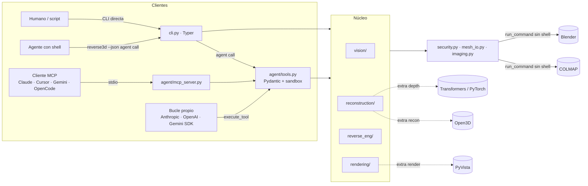

# Arquitectura

## Vista general

## Capas

| Capa | Módulos | Responsabilidad |
|------|---------|-----------------|
| Interfaces | `cli.py`, `agent/mcp_server.py` | Parseo de argumentos, formato de salida, códigos de salida |
| Agente | `agent/tools.py` | Registro único de herramientas, esquemas por proveedor, validación estricta, sandbox, errores estructurados |
| Dominio | `vision/`, `reconstruction/`, `reverse_eng/`, `rendering/` | Algoritmos; funciones puras siempre que sea posible, con `dataclass` de resultado y `to_dict()` |
| Infraestructura segura | `security.py`, `mesh_io.py`, `imaging.py`, `config.py`, `errors.py`, `logging_utils.py` | Validación de rutas y archivos, E/S segura, procesos externos, límites y errores |

**Reglas de dependencia:** las interfaces dependen del dominio, y el dominio depende de la infraestructura. El dominio nunca importa `cli` ni `agent`. Las dependencias opcionales pesadas (Open3D, PyTorch, PyVista, MCP) se importan **dentro** de las funciones que las usan, de modo que `import reverse3d` es siempre ligero y los errores de dependencias son `DependencyMissingError` con un `hint` de instalación.

## Módulos

### Capa de automatización (v0.2)

| Módulo | Responsabilidad |
|--------|-----------------|
| `userconfig.py` | `~/.reverse3d/config.json`: lectura, validación, escritura atómica y lista blanca para agentes |
| `hardware.py` | Detección de GPU (`nvidia-smi`, Apple MPS), resolución de `device` por backend (COLMAP/Blender, PyTorch) y control de hilos |
| `profiles.py` | Perfiles `fast`, `balanced` y `quality`: calidad de fotogrametría, muestras y resolución de render, stride de profundidad, muestras de primitivas |
| `recipes.py` | Flujos de una llamada; resumen corto para el agente e informe completo en `report.json` |
| `agent/compact.py` | Compactación de resultados para ahorrar tokens |
| `agent/prompts.py` | Prompts MCP (comandos `/`) e instrucciones del servidor |
| `agent/skill/SKILL.md` | Agent Skill para Claude Code (carga bajo demanda) |
| `setup_agents.py` | Registro idempotente del MCP en 8 agentes, con backups |
| `scripts/install.*` | Instaladores de un comando sin privilegios |

**Precedencia de configuración:** defaults ← `config.json` ← variables de entorno ← opciones de la CLI (`--device`, `--profile`, `--workspace`). El servidor MCP llama a un *settings provider* en cada petición.

### `vision/mask_extractor.py`
Umbralización Otsu, adaptativa, Canny o por canal alfa. La inversión se detecta por los bordes de la imagen. Después se aplica morfología de cierre y apertura, se extraen contornos con jerarquía `RETR_CCOMP` (exteriores con sus agujeros) y se simplifican con Douglas-Peucker. Salidas: máscara PNG, contornos JSON versionados (`schema_version`) y SVG. `silhouette_to_mesh` extruye los polígonos con Shapely + trimesh, invirtiendo el eje Y de la imagen y aplicando la escala `units_per_pixel`.

### `vision/feature_matcher.py`
Métricas por imagen: nitidez (varianza del Laplaciano), brillo, contraste y keypoints. El matching usa SIFT u ORB con ratio test de Lowe y verificación RANSAC de la matriz fundamental. `analyze_image_set` asume una captura secuencial (pares consecutivos más el cierre del anillo) y produce recomendaciones.

> Los umbrales (nitidez < 100, keypoints < 500, inliers por par < 40) se calibraron con imágenes reescaladas a 1600 px. Son heurísticos y orientativos.

### `reconstruction/photogrammetry.py`
`ColmapPipeline` encadena `feature_extractor`, `{exhaustive|sequential}_matcher`, `mapper`, `model_analyzer`, `model_converter` y, opcionalmente, `image_undistorter`, `patch_match_stereo` y `stereo_fusion`. Decisiones clave:
- **Sondeo de opciones** con `colmap <cmd> -h`, porque COLMAP renombró opciones entre versiones (`SiftExtraction.use_gpu` → `FeatureExtraction.use_gpu`).
- **Staging** de imágenes validadas en `<output>/images`, para que COLMAP solo lea archivos ya verificados.
- **Selección del modelo** con más imágenes registradas cuando el mapper produce varios.
- **Degradación**: en modo `dense=auto`, un fallo del MVS (por ejemplo, sin CUDA) produce un aviso y se continúa con la nube dispersa.

### `reconstruction/depth_estimation.py`
Depth Anything V2 vía `transformers.pipeline`, limitado a una lista blanca de modelos, con `trust_remote_code=False` y `use_safetensors=True`. `depth_to_mesh` retroproyecta con un modelo pinhole (FOV configurable), interpola en disparidad inversa y elimina triángulos que cruzan discontinuidades de profundidad.

### `reconstruction/pointcloud.py`
Pipeline de Poisson con Open3D: downsample → eliminación de outliers → normales orientadas → Poisson → recorte por densidad (quita el "globo" extrapolado) → recorte a la caja de la nube.

### `reverse_eng/mesh_cleaner.py`
Pasos en orden: saneado → filtrado de componentes **por área** (no por número de caras, que depende de la teselación) → relleno de agujeros (trimesh para los pequeños; abanico desde el centroide del bucle para los mayores, conservando el winding) → normales → Taubin (preserva volumen) → decimación cuádrica → alineación OBB/PCA → apoyo en el suelo → escala. Devuelve estadísticas antes y después.

### `reverse_eng/geometry_fit.py`
RANSAC en NumPy puro, determinista con semilla:
- **Plano:** 3 puntos y refinamiento SVD.
- **Esfera:** 4 puntos con ajuste algebraico y refinamiento por mínimos cuadrados.
- **Cilindro:** hipótesis de eje `n₁ × n₂` a partir de normales, círculo de Kåsa en el plano perpendicular; el refinamiento toma como eje el autovector de menor autovalor de la dispersión de normales de los inliers.

`detect_primitives` extrae primitivas de forma secuencial: la que más puntos explica gana y, en caso de empate, la más simple.

### `reverse_eng/parametric.py`
Genera OpenSCAD (`multmatrix`, `cylinder`, `sphere`) y CadQuery (`Workplane(Plane(...))`). Solo emite valores numéricos formateados con `float()`, por lo que no es posible inyectar código a través de los datos.

### `rendering/`
`blender_render.py` valida las opciones y escribe un job JSON. `_blender_job.py` es un script **estático** que corre dentro de Blender: importa la malla (soporta los operadores nuevos y los antiguos), la normaliza, aplica un material Principled, monta iluminación de tres puntos y una cámara con track-to sobre un rig, y opcionalmente un shadow catcher y un turntable. `preview.py` ofrece la alternativa con PyVista offscreen.

## Decisiones (ADR resumidas)

| # | Decisión | Alternativas | Razón |
|---|----------|--------------|-------|
| 1 | CLI con Typer y choices como `str`-Enum | Click directo, `Literal` | Typer 0.2x vendoriza Click; Enum es la API estable entre versiones |
| 2 | RANSAC propio en NumPy | `open3d.segment_plane`, pyransac3d | Sin dependencias pesadas, determinista, testeable, con cilindros y esferas |
| 3 | Blender mediante un script estático + JSON | Generar código `bpy` | Elimina la inyección de código por diseño |
| 4 | Un registro único de herramientas | Esquemas mantenidos a mano | Un solo punto de verdad para Anthropic, OpenAI, Gemini, MCP y la CLI; un test verifica que `docs/tools` está sincronizado |
| 5 | MCP solo por stdio | HTTP/SSE | Sin superficie de red ni autenticación que gestionar |
| 6 | Apache-2.0 | MIT, GPL | Permisiva y con concesión explícita de patentes, adecuada para uso industrial |
